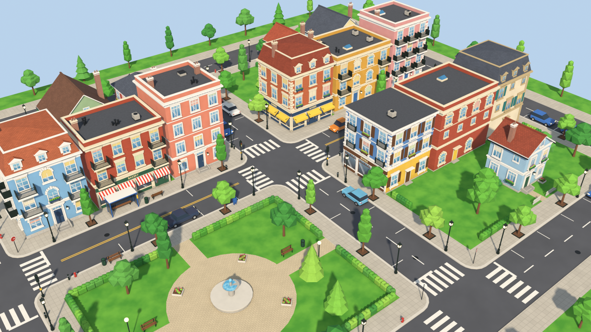
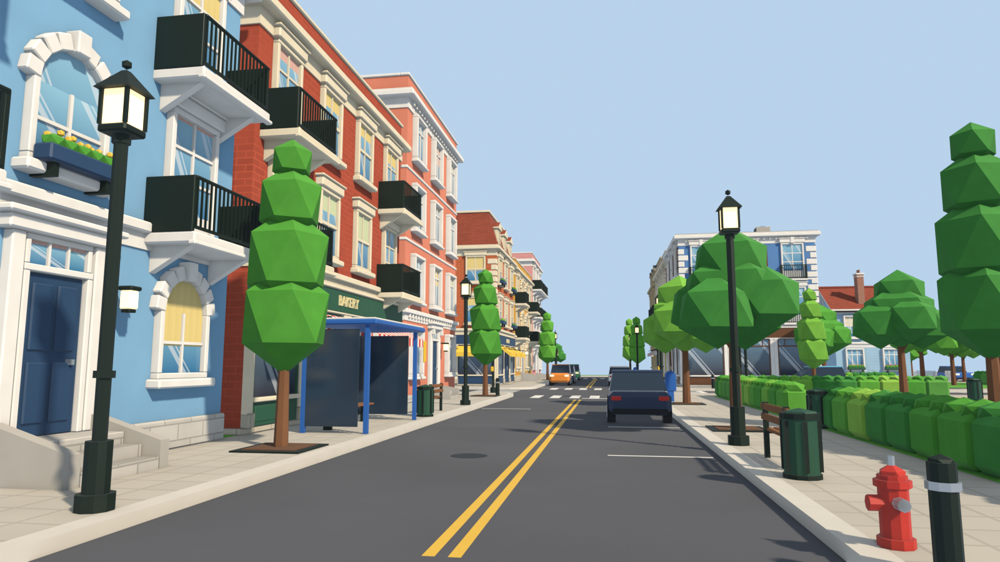
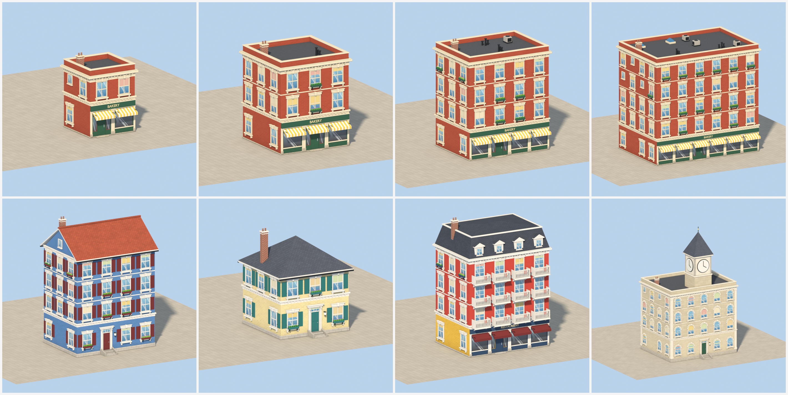
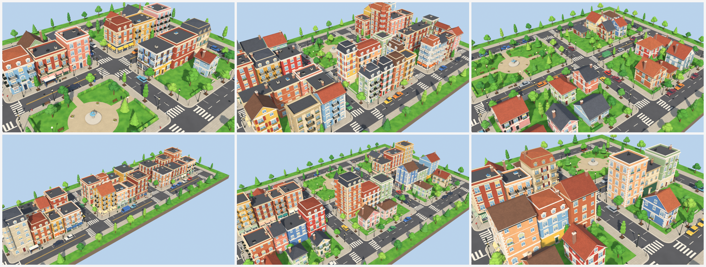
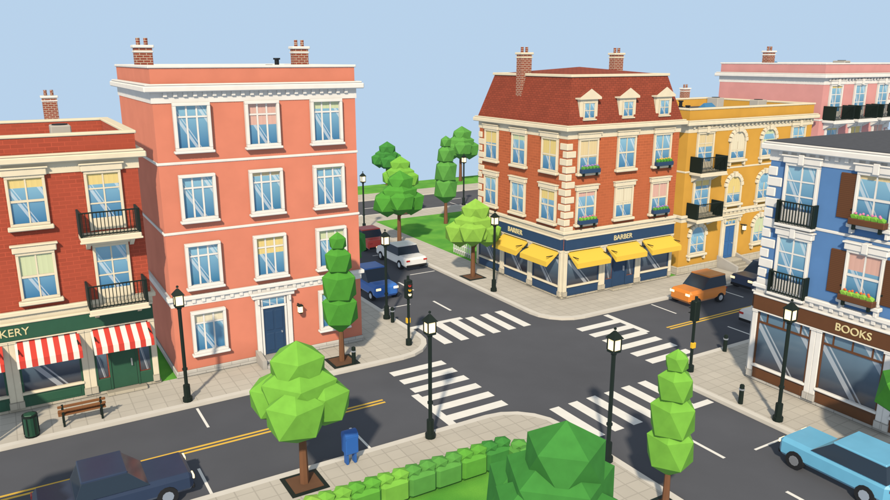

# Open City

**A free, open source small-town generator for Blender.** Click *Add Town*, pick a preset and you get a
colourful, walkable neighbourhood: brick and painted townhouses, corner shops with awnings and signs,
cafes, a park with a fountain, houses in gardens, kerbed sidewalks, crossings, street lights, trees,
benches and parked cars. Every building is assembled from a modular architectural kit, so it can be
made wider, deeper or taller without anything being stretched.





## Features

- **Modular buildings.** Facades are grids of bays and floors. Each slot takes a module (sash, arched
  or wide window, French door, storefront, shop door, front door with stoop) plus add-ons stacked on
  it (shutters, flower boxes, iron or stone balconies, striped awnings). Plinths, belt courses,
  dentil cornices, string courses, quoins and pilasters are built to the footprint.
- **Resize without distortion.** More bays add windows, more floors add storeys and move every band
  and the roof up; modules are rebuilt to fit, never scaled.
- **Roofs and landmarks.** Parapet, flat, gable (ridge along or across), hip and mansard roofs with
  dormers, chimneys and rooftop clutter; corner turrets and clock towers.
- **Small-town layout.** A grid of kerbed blocks round a main street. Main-street blocks get corner
  buildings and continuous shop rows; quiet streets get townhouses or detached houses with front
  gardens; some blocks become parks.
- **Rule-based details.** Lamps, street trees, benches, bins, hydrants, mailboxes, bollards, signs,
  traffic lights, a bus shelter, bike racks, cafe tables, sandwich boards and planters are placed on
  sidewalk zones that keep doors, stoops, corners and crossings clear. Cars park along the kerbs facing
  the traffic; vans stop outside grocers and bakeries.
- **Moving traffic.** Press play and cars drive round the blocks in the right-hand lanes, turning at the
  corners. Every lane carries one loop and no two loops cross, so cars never drive through each other;
  narrow streets park on one side only to leave room for two lanes.
- **Day and night.** *Night* turns on the lit windows, glowing shop signs, street and park lamps that throw
  warm pools of light, headlights and tail lights on the traffic, a starry sky and a soft bloom.
- **No edge of the world.** The town sits in a valley of wooded hills (or a forest, or open fields), so the
  view down every street ends in trees, and the land runs out past the horizon.
- **Every building is its own object**, with its own live settings: edit it, re-roll its style or
  lock it, and the rest of the town is untouched.
- **Reproducible.** The same seed and settings always give the same town.
- **Fast.** One building re-evaluates in about 25 ms; a whole town regenerates in about 0.1 s after
  the node groups are built once.
- **Saved files keep working** without the add-on: buildings, props and traffic are Geometry Nodes (the
  traffic runs on the scene clock, no drivers or scripts), the ground is an ordinary mesh.







## Install

Requires **Blender 5.2** or newer. Download `open_city-0.3.0.zip`, then *Edit > Preferences > Get
Extensions > (arrow menu) > Install from Disk*. Keep it zipped.

## Use

1. In the 3D viewport press **N** and open the **City** tab, or use *Add > Mesh > Town*.
2. Pick a preset: Main Street, Old Quarter, Garden Suburb, Brick Town or Market Town.
3. Select the town (its empty) to change the town settings: blocks, block size, street and sidewalk
   width, density, floors, shops, landmarks, brick share, parking, traffic and its speed, lights, trees,
   furniture and the surroundings.
   With *Live Update* on, the town regenerates as you drag.
4. Select a building to edit it: bays, floors, window style, shutters, balconies, ground-floor use,
   shop name, awnings, roof, tower, wall material and colours. *Re-roll Style* gives it a new look on
   the same footprint and locks it. Locked buildings survive regeneration.
5. *Tools > Day* lights the scene like the screenshots; *Night* turns the lights on. Press play to see
   the traffic move. *Make Real* bakes the town to one mesh (the traffic as it stands at that frame).
   *Add One Building* places a single kit building at the cursor.

## How it works

| System | Where |
| --- | --- |
| Modular architectural assets | `kit/` (openings, roofs, street, nature, vehicles, parts) |
| Parametric building assembly | `building.py` (shell, facade, roof and tower sub-groups) |
| Facade and floor generation | `building.py` `_facade`: the slot grid and module rules |
| Building types and styles | `styles.py`: roles, colour schemes, shop names |
| Street and block layout | `layout.py`: streets, zoning, lot packing |
| Environmental props, traffic, countryside | `placement.py`, `ground.py` |
| Day and night | `stage.py`, `lights.py` |
| Materials and colour variation | `materials.py` |
| Settings and seeds | `params.py`, `props.py` |

The town is planned in plain Python, so the same rules can be tested without Blender. Buildings read
their palette from attributes, so a whole town shares a handful of materials. See
[CONTRIBUTING.md](CONTRIBUTING.md) to add a module, a style or a prop.

## Tests

```
blender -b --factory-startup --python tests/run_tests.py
```

## License

GPL-3.0-or-later.
